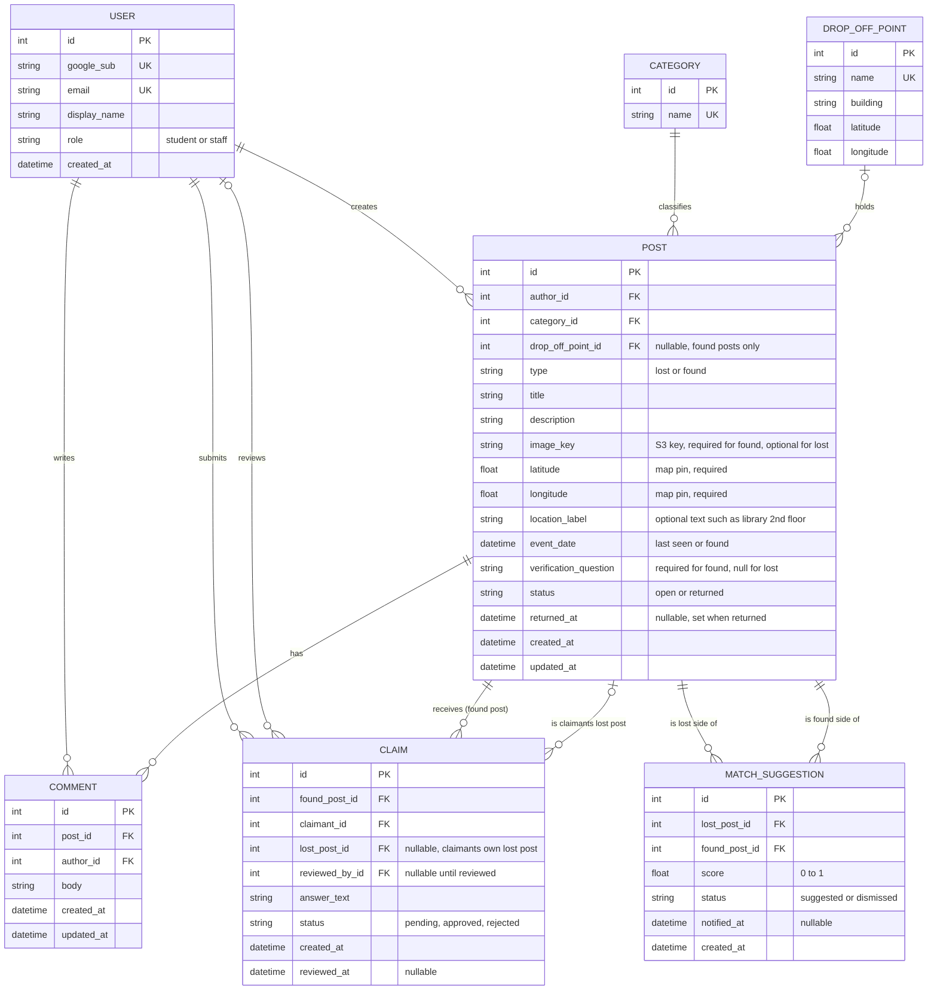

# FoundIt ERD

## Cardinalities (min and max on both sides)

| Relationship | Left side | Right side |
|---|---|---|
| USER - POST | a post has exactly one author (1..1) | a user has zero or many posts (0..*) |
| USER - COMMENT | a comment has exactly one author (1..1) | a user has zero or many comments (0..*) |
| POST - COMMENT | a comment belongs to exactly one post (1..1) | a post has zero or many comments (0..*) |
| POST - CLAIM (target) | a claim targets exactly one found post (1..1) | a found post has zero or many claims (0..*) |
| USER - CLAIM (submits) | a claim has exactly one claimant (1..1) | a user has zero or many claims (0..*) |
| USER - CLAIM (reviews) | a claim has zero or one reviewer, null until reviewed (0..1) | a user reviews zero or many claims (0..*) |
| POST - CLAIM (claimant's lost post) | a claim links to zero or one lost post (0..1) | a lost post is linked from zero or many claims (0..*) |
| CATEGORY - POST | a post has exactly one category (1..1) | a category has zero or many posts (0..*) |
| DROP_OFF_POINT - POST | a post has zero or one drop-off point (0..1) | a drop-off point holds zero or many posts (0..*) |
| POST - MATCH_SUGGESTION (lost side) | a suggestion has exactly one lost post (1..1) | a lost post has zero or many suggestions (0..*) |
| POST - MATCH_SUGGESTION (found side) | a suggestion has exactly one found post (1..1) | a found post has zero or many suggestions (0..*) |

## Integrity rules (cannot be drawn in an ERD, enforced in the database or app)

**Post rules**
- `type` is `lost` or `found`; `status` is `open` or `returned`.
- Found posts require `image_key` and `verification_question`. Lost posts must have `verification_question` and `drop_off_point_id` null.
- `latitude` is between -90 and 90, `longitude` between -180 and 180, both required.
- `event_date` cannot be in the future.
- `returned_at` is set if and only if `status` is `returned`.

**Claim rules**
- `found_post_id` must reference a post with `type = 'found'`.
- `lost_post_id`, if set, must reference a `lost` post authored by the claimant.
- A user cannot claim their own found post.
- Unique (`found_post_id`, `claimant_id`): one claim per user per found post.
- At most one `approved` claim per found post (partial unique index).
- `reviewed_by_id` must be the found post's author or a user with role `staff`. `reviewed_by_id` and `reviewed_at` are set if and only if `status` is not `pending`.

**Match suggestion rules**
- `lost_post_id` must reference a `lost` post and `found_post_id` a `found` post.
- Unique (`lost_post_id`, `found_post_id`): no duplicate suggestions.
- `score` is between 0 and 1.

**User rules**
- `email` must be a campus Google address; `google_sub` is unique.
- A finder's contact details (email) are revealed only after a claim on their post is `approved`.

## Return flow (Returned status)

When a claim is approved: the found post becomes `returned`, the claimant's linked lost post (`claim.lost_post_id`) becomes `returned`, and all other pending claims on that found post become `rejected`.

## Delete behavior

| Deleting... | Effect |
|---|---|
| Post | cascades to its comments, claims, and match suggestions; `claim.lost_post_id` pointing at it is set to null |
| Comment | removed, nothing else affected |
| User | restricted (deactivate or anonymize instead of hard delete) |
| Category | restricted while posts use it |
| Drop-off point | `post.drop_off_point_id` set to null |

## Edge cases covered

- Lost post with no photo (photo optional for lost, required for found).
- Claim by someone who never posted a lost item (`lost_post_id` is null).
- Multiple people claiming the same item; only one can be approved.
- Staff logging a found item at a drop-off point (staff is just a user with a `staff` role; `drop_off_point_id` is set).
- Post, comment, or claim deleted after others reference it (see delete behavior).
- Lost and found posts with no match yet (zero suggestions allowed).
- User dismisses a suggestion (`status = dismissed`).
